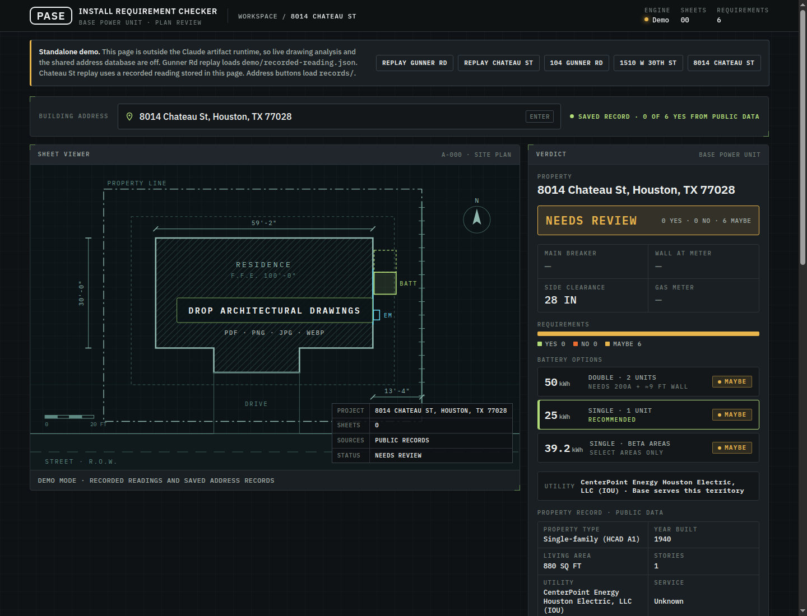
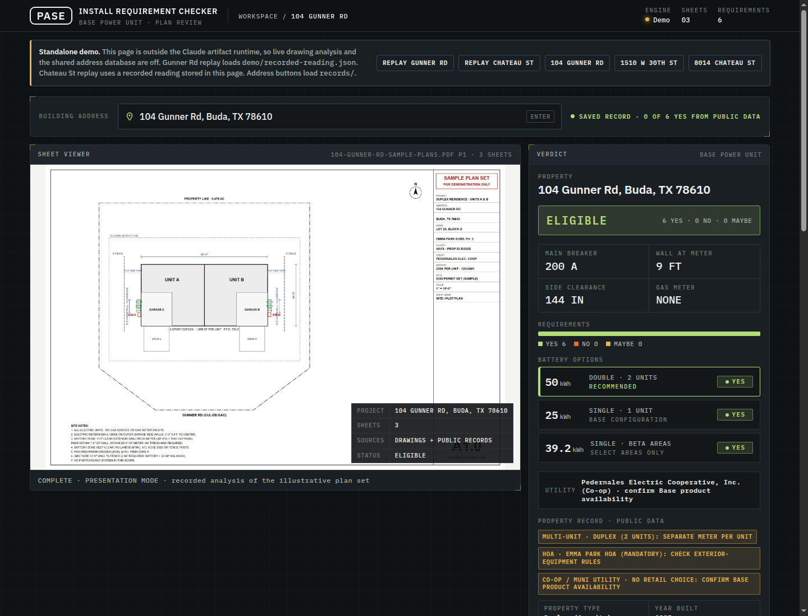

# Base Power Install Requirement Checker

Pre-screen a Texas home for a Base Power battery before anyone visits the site or asks for drawings.

The checker covers the 25 kWh single unit, the 50 kWh double, and the 39.2 kWh beta unit. It scores the same six install requirements as YES, NO, or MAYBE, each with a source and a note.

Two paths feed that score:

1. **Address-only screen.** Free public data (county appraisal records, parcel and lot geometry, building footprints, FEMA flood zone, USGS slope, PUCT utility territory, city permits where a public API exists). Google Street View is a capped, paid fallback. The screen runs before a site visit or a request for drawings.
2. **Architectural-drawing reading.** When a plot plan, electrical riser, and elevation are available, the checker reads them, answers the same requirements, and draws a to-scale install envelope from what the sheets show.





Live demo, once Pages is enabled: <https://henheck.github.io/BASEHACKATHON/>

## Quickstart

Node 20 or newer is required for the local server and the address screen. There is nothing to install.

```bash
git clone https://github.com/henheck/BASEHACKATHON.git
cd BASEHACKATHON
npm start
```

Open <http://127.0.0.1:4173/>. The root redirects to `checker.html`.

Opening `checker.html` as a `file://` URL will not load the demo JSON. Use `npm start` or any static host.

`npm test` runs the smoke test.

### Standalone page vs Claude artifact

`checker.html` is one file.

Inside Claude, with the artifact runtime (`sample` and `db`), it reads dropped drawings and looks up the shared address database. That path is unchanged.

Opened anywhere else, live drawing analysis and the shared database are off. A banner says so. The page does not throw.

- **Gunner Rd replay** loads [`demo/recorded-reading.json`](demo/recorded-reading.json). Open `checker.html?replay=gunner` or use the banner button. Dropping `demo/104-Gunner-Rd-SAMPLE-PLANS.pdf` does the same.
- **Chateau St replay** uses a recorded reading stored in the page (there is no second JSON file for it). Drop `demo/8014-Chateau-St-Houston-ARCH.pdf` or use the banner button.
- **Address lookup** reads `records/<key>.json` for the three screened homes:
  - 104 Gunner Rd, Buda, TX 78610
  - 1510 W 30th St, Austin, TX 78703
  - 8014 Chateau St, Houston, TX 77028

Other drawings are not analyzed outside the artifact runtime. The status line says so. It is not an error.

## Run the address screen

```bash
cp .env.example .env
npm run screen -- "104 Gunner Rd, Buda, TX 78610" --facts facts/104-gunner-rd.json
```

Or without npm:

```bash
node tx-screen.mjs "<address>" [--facts facts/<address-key>.json]
```

The script geocodes the address, then queries parcel, utility, flood, slope, footprint, county appraisal, optional Street View, and city permits where a public API exists. It writes `records/<address-key>.json`.

`--facts` merges a JSON object of manually researched facts (year built, sqft, HOA, and so on) that are not wired to an automated source for that county. See `facts/`.

### Environment

| Variable | Required | Where it is read |
|---|---|---|
| `GOOGLE_MAPS_API_KEY` | Only for Street View | Environment, then `~/claude/.env`, then `./.env` |
| `GOOGLE_USAGE_PATH` | No | Ledger file. Default `~/claude/google-usage.json` |
| `PORT` | No | `npm start` only. Default `4173` |

Street View is optional. Without a key, the rest of the screen still runs and that source is logged as failed.

The key is for the Street View Static API. Restrict it to that API (Solar or Map Tiles only if you mean to use them). Never commit it. `.env` and `google-usage.json` are gitignored. A copy of the real key does not belong in this repo.

Image spend is capped at 3 images per address and 300 images per month. Metadata lookups are free and run first, so an address with no imagery does not spend the cap.

## Requirements

| # | Requirement |
|---|---|
| C1 | Panel size: 100-200A main breaker, single main panel |
| C2 | Meter and panel location: exterior wall, at or below 6 ft, panel on the same wall |
| C3 | Wall space at the meter: at least 6 ft clear wall, no windows or doors |
| C4 | Side clearance: at least 56 in wall to fence or lot line |
| C5 | Gas-meter separation: at least 3 ft, or no gas service |
| C6 | NEC check: 110.26 working space, 240.24(D) not in a closet, 110.12 meter and mast condition |

The drawing reader scores 20 electrical and spacing checks, then collapses them into these six. The address screen scores the same 20. Scope is Texas only. Out-of-state addresses are rejected.

## Data sources and costs

- **Free, unlimited:** US Census and Esri geocoding, TxGIO statewide parcels, FEMA NFHL flood zones, USGS 3DEP elevation, PUCT utility service-area boundaries, OpenStreetMap building footprints, city open permit APIs (Austin and Dallas, where they exist).
- **Free, semi-automated:** county appraisal current-roll data. Wired for Hays County. Other counties need a per-county bulk-export parser.
- **Paid, capped:** Google Street View Static API, last resort for finding the meter wall. See the caps above. The ledger lives outside this repo.

## Repository layout

```
checker.html          Interactive checker
index.html            Root redirect for GitHub Pages
tx-screen.mjs         Address screen
streetview.mjs        Capped Street View capture
records/              One JSON record per screened address
facts/                Manual facts for --facts
demo/                 Synthetic plan sets, generators, recorded reading
docs/                 Screenshots used above
scripts/serve.mjs     Local static server (npm start)
test/smoke.test.mjs   Smoke test (npm test)
.github/workflows/    CI and Pages deploy
```

`bulk/` is local scratch for large county appraisal downloads. It is gitignored. Re-fetch from the county appraisal district's public data-export page. Do not commit those files. Redistribution of the raw county data is not ours to grant.

`records/*_streetview/` is gitignored. Those are real photos of real addresses, and Google's terms do not allow redistributing them. Regenerate locally with the screen script. The JSON records store filenames and dates only.

`demo/` plan sets are synthetic. They were generated from public parcel and appraisal data plus assumptions about panel size and meter placement. Every sheet is watermarked "Illustrative sample · Not for construction". They are not the builder or architect plans for those addresses.

## GitHub Pages

The workflow `.github/workflows/pages.yml` deploys `index.html`, `checker.html`, `demo/`, and `records/` on every push to `main`.

Someone with admin on the repo has to turn the site on once:

1. GitHub repo **Settings**, **Pages**, **Build and deployment**, **Source**: **GitHub Actions**.
2. Merge the workflow to `main` (or run it with **workflow_dispatch**).
3. The site is <https://henheck.github.io/BASEHACKATHON/>.

Until that setting is saved, the workflow fails on the deploy job. That is a repo setting, not a code failure.

## Limitations

- Meter and gas-meter placement are never in public records. The address-only path can flag likely trouble (a narrow side yard) or confirm a pass when a permit states the amperage. Closing the gap needs builder or architect drawings, a homeowner photo, or a utility service-location partnership.
- County appraisal current-roll parsing is implemented for Hays County only. Harris (Houston) and Travis (Austin) fall back to the older, less complete statewide parcel layer.
- City permit APIs are wired for Austin and Dallas. Houston and San Antonio permits are not a queryable API. They would need scraping or a bulk file.
- The standalone page cannot read a new set of drawings. That needs the Claude artifact runtime.
- Street View imagery and county bulk exports are intentionally not in git. See `.gitignore`.

## License

MIT. See [LICENSE](LICENSE).
